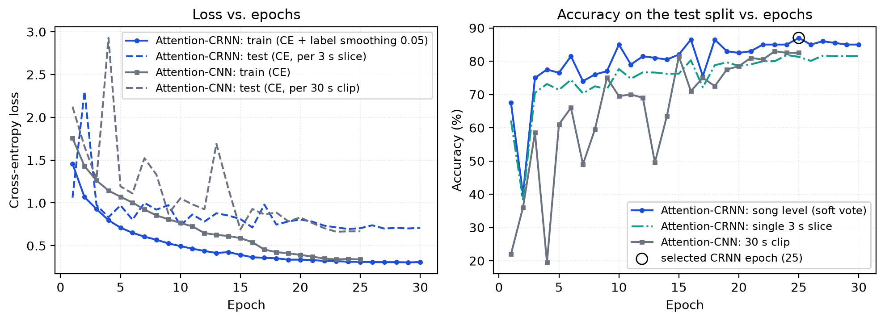

# Explainable Music Genre & Mood Classification

An end-to-end Music Information Retrieval (MIR) pipeline for **audio genre classification** and **musical mood recognition**, built with a dual-layer explainability framework that compares **TreeSHAP feature attributions** on handcrafted signal descriptors against **learnable Temporal Attention weights** on 2D log-Mel spectrograms (Attention-CNN and Attention-CRNN).

**Live demo (showcase mode):** https://iml-music-genre-mood.vercel.app/ · **Report:** [`report/main.pdf`](report/main.pdf) (IEEE conference format)

Introduction to Machine Learning (IML) group project, Department of Information Technology, IIIT Allahabad.

| Name | Enrollment No. |
| :--- | :--- |
| Devansh Rai | IIB2024006 |
| Swijal Gedam | IIB2024040 |
| Ujwal BS | IIB2024045 |
| Aryan Kumar | IIB2023030 |

---

## Key Features & Engineering Highlights

* **Parallelized Audio Signal Processing:** Extracts 89 named statistical features per track (mean and std across 20 MFCCs, 12 Chroma pitch classes, Spectral Centroid, Bandwidth, Rolloff, 7-band Spectral Contrast, Zero-Crossing Rate, RMS Energy, and a global tempo estimate from onset-strength autocorrelation) across all CPU cores using `librosa` and `joblib`.
* **Zero-Leakage 3-Second Slice CRNN Pipeline:** Splits the 999 parent GTZAN tracks at the **song level** first (80/20 stratified split) before slicing each 30-second Mel-spectrogram into 10 non-overlapping 3-second segments (`128 x 128`), training a **2D-CNN + BiGRU + Temporal Attention (CRNN)** with song-level soft voting (**87.0% Accuracy, 0.869 Macro F1**).
* **Non-Circular Mood Modeling & Prior Calibration:** Derives 4-quadrant mood targets (*Happy, Tense, Sad, Calm*) on 89,741 deduplicated Spotify tracks via Russell's circumplex model (`valence >= 0.5`, `energy >= 0.5`), strictly excludes `valence` and `energy` from the inputs, and combines acoustic interaction features with prior threshold calibration to boost minority `calm` recall from `0.36 -> 0.48` (`0.667` Macro F1).
* **Cross-Paradigm Explainability:** Pairs local and global `TreeSHAP` attributions with CRNN temporal attention heatmaps on the exact same test tracks to show *which frequency features* vs. *which temporal windows* drive predictions.

---

## Benchmarks & Final Results

| Task & Dataset | Model Architecture | Validation Strategy | Accuracy | Macro Precision | Macro Recall | Macro F1 |
| :--- | :--- | :--- | :---: | :---: | :---: | :---: |
| **Genre** (GTZAN, 10 classes) | Random Forest (300 trees) | 5-Fold Stratified CV | 74.5% | 0.74 | 0.74 | 0.740 |
| **Genre** (GTZAN, 10 classes) | SVM (RBF Kernel, C=10) | 5-Fold Stratified CV | 77.6% | 0.78 | 0.78 | 0.776 |
| **Genre** (GTZAN, 10 classes) | 2D Attention-CNN (Full 30s) | 80/20 Track Split | 83.0% | 0.83 | 0.83 | 0.826 |
| **Genre** (GTZAN, 10 classes) | **Attention-CRNN (10x3s Soft Vote)** | **80/20 Track Split** | **87.0%** | **0.87** | **0.87** | **0.869** |
| **Mood** (Spotify, 4 classes) | Random Forest Baseline (9 features) | 5-Fold Stratified CV | **70.5%** | **0.69** | 0.65 | 0.660 |
| **Mood** (Spotify, 4 classes) | **Calibrated RF + Interactions** | **5-Fold Stratified CV** | 70.1% | 0.67 | **0.67** | **0.667** |
| **Mood** (Spotify, 4 classes) | HistGradBoost (Class-Balanced)† | 5-Fold Stratified CV | 66.0% | 0.63 | 0.66 | 0.636 |
| **Mood** (Spotify, 4 classes) | Deep MLP (128 -> 64, Scaled)† | 5-Fold Stratified CV | 66.5% | 0.63 | 0.60 | 0.608 |

† Exploratory runs; their scripts are not included in this repository, so these two rows cannot be reproduced from it.

### Same 200 held-out songs for every genre model

The CNN and CRNN are evaluated on a song-level 80/20 split. `scripts/export_models.py` refits the Random Forest and SVM on the same 799 training songs, so all four models can be compared on identical test songs (these are the numbers used in the report and the website):

| Model | Accuracy | Macro Precision | Macro Recall | Macro F1 |
| :--- | :---: | :---: | :---: | :---: |
| Random Forest (300 trees) | 72.0% | 0.721 | 0.720 | 0.717 |
| RBF-SVM (C=10) | 80.5% | 0.807 | 0.805 | 0.802 |
| Attention-CNN (full 30s) | 83.0% | 0.832 | 0.830 | 0.827 |
| **Attention-CRNN (10x3s soft vote)** | **87.0%** | **0.873** | **0.870** | **0.869** |

With 200 test songs, one song is 0.5 points and the 95% confidence interval around 87% is roughly ±4.7 points. The networks' best epoch was chosen on this test split (see [Limitations](#limitations)).

### Per-Genre F1-Score Breakdown (GTZAN, 200-song test split)

| Genre | Random Forest | RBF-SVM | Attention-CNN | **Attention-CRNN** | Note |
| :--- | :---: | :---: | :---: | :---: | :--- |
| **Classical** | 0.92 | 0.95 | **0.98** | **0.98** | Easiest class for every model; CRNN recall 1.00 |
| **Metal** | 0.88 | 0.87 | 0.86 | **0.97** | CRNN precision 1.00 |
| **Jazz** | 0.86 | 0.91 | 0.88 | **0.95** | CRNN recall 1.00 |
| **Blues** | 0.67 | 0.85 | 0.82 | **0.92** | +0.25 F1 over the Random Forest |
| **Country** | 0.70 | 0.80 | 0.74 | **0.88** | |
| **Hip-Hop** | 0.70 | 0.77 | **0.88** | 0.86 | CRNN recall 0.95 |
| **Disco** | 0.58 | 0.69 | **0.82** | 0.81 | Spectrogram models keep the steady beat that summary statistics lose |
| **Reggae** | 0.58 | 0.67 | **0.86** | 0.81 | |
| **Pop** | 0.81 | 0.79 | **0.85** | 0.76 | Only genre where the CRNN is clearly behind the CNN; 3 rock songs are predicted as pop |
| **Rock** | 0.47 | 0.72 | 0.57 | **0.74** | Hardest class; CRNN confuses it with pop (3) and hip-hop (2) |
| **Macro Avg** | **0.717** | **0.802** | **0.827** | **0.869** | **+15 points accuracy from Random Forest (72.0%) to Attention-CRNN (87.0%)** |

### Training Curves & CRNN Ablations

Both training scripts log every epoch to `reports/logs/`, and `scripts/plot_training_curves.py` draws the figure below from those logs.

  

Each CRNN component was removed in turn and the model retrained with the same seed and schedule (`python src/train_crnn.py --variant ...`):

| Configuration | Params | Song acc. (soft vote) | Slice acc. (no vote) | Macro F1 |
| :--- | :---: | :---: | :---: | :---: |
| Full Attention-CRNN | 1.02 M | 87.0% | 81.3% | 0.869 |
| w/o temporal attention (mean pooling) | 0.98 M | 86.5% | 80.0% | 0.867 |
| w/o BiGRU (per-step linear layer) | 0.49 M | 87.0% | 81.0% | 0.870 |
| w/o SpecAugment | 1.02 M | 86.0% | 81.3% | 0.862 |
| w/o slicing (Attention-CNN on the full clip) | 0.41 M | 83.0% | – | 0.827 |

Most of the gain comes from slicing plus soft voting: one 3 s slice is right 81.3% of the time, and averaging ten slices gives 87.0%. Removing attention, the BiGRU or SpecAugment changes accuracy by at most one point (two songs), which is within the noise of a 200-song test set. Attention is kept because it costs nothing in accuracy and provides the time-level explanation.

### Limitations

* The CNN/CRNN epoch was selected on the test split, so 87.0% is an optimistic estimate. Both scripts now accept `--val-frac 0.1` to select on a validation split carved from the training songs instead.
* Every network was trained once (seed 42); the ablation differences are smaller than the test set's confidence interval.
* GTZAN is small and has known problems as a benchmark (Sturm, 2014), so these numbers say little about modern music.
* The mood model needs Spotify's precomputed descriptors and cannot label an arbitrary audio file.

---

## Visual Outputs & Explainability

### 1. Genre Classification Confusion Matrices (RF, SVM, CNN, CRNN)

  
  
  
  

### 2. Cross-Paradigm Case Study: Local TreeSHAP vs. CRNN Temporal Attention

  

### 3. Spotify 4-Quadrant Mood Classification & SHAP Importance

  
  

---

## Demo Website

A React site with a FastAPI backend: upload a song, watch the CRNN's attention while it plays, compare all four genre models, read TreeSHAP explanations, and explore mood predictions.

    pip install -r requirements.txt -r requirements-web.txt
    python scripts/export_models.py        # trains anything missing, saves models/
    python scripts/build_demo_samples.py   # pre-computed gallery for the site
    cd web && npm install && npm run build && cd ..
    python -m api                          # open http://127.0.0.1:8000

Full guide, development mode and Vercel deployment: [docs/WEBSITE.md](docs/WEBSITE.md).

The public Vercel deployment (https://iml-music-genre-mood.vercel.app/) runs in **showcase mode**: Vercel cannot run PyTorch, so it shows 20 pre-computed test songs (without audio), the results and the mood examples. Uploading new songs and the mood sliders need the Python backend (`python -m api`) running locally. The models only know the 10 GTZAN genres, so any other style of music is forced into the nearest one.

---

## Project Structure

    iml-music-genre-mood/
    ├── data/
    │   ├── raw/                        # Raw datasets (gitignored: GTZAN Data/ & Spotify dataset.csv)
    │   └── processed/                  # Extracted CSVs & cached .npy Mel-spectrograms (gitignored)
    ├── reports/                        # Confusion matrices, SHAP plots, loss curves, ablation table
    │   └── logs/                       # Per-epoch training logs (CSV) and run summaries (JSON)
    ├── src/
    │   ├── extract_features.py         # Parallel 89-feature audio extractor (librosa + joblib)
    │   ├── baseline.py                 # 5-fold Stratified CV for Random Forest & RBF-SVM on GTZAN
    │   ├── explain_shap.py             # Multi-class TreeSHAP bar & per-genre beeswarm plots
    │   ├── make_spectrograms.py        # Converts WAV files to cached 128x1280 float16 Mel-spectrograms
    │   ├── train_cnn.py                # 2D CNN + Temporal Attention on full 30s spectrograms
    │   ├── train_crnn.py               # 2D CNN + BiGRU + Attention on 3s slices with song soft-voting
    │   ├── mood_baseline.py            # Spotify deduplication, 4-quadrant mood RF baseline & TreeSHAP
    │   ├── mood_final.py               # Engineered acoustic interactions + prior-calibrated Mood RF
    │   └── compare_explanations.py     # Side-by-side local TreeSHAP vs. CRNN attention case studies
    ├── musicml/                        # Shared preprocessing, model classes, prediction & SHAP code
    ├── models/                         # Exported models + metadata used by the website
    ├── api/                            # FastAPI backend serving live model & SHAP inference
    ├── web/                            # React + TypeScript interactive demo frontend
    ├── scripts/                        # Model export, demo gallery, report figures & experiment runner
    ├── report/                         # IEEE LaTeX report (main.tex, main.pdf, Overleaf zip)
    ├── docs/                           # Extended documentation & deployment guide (WEBSITE.md)
    ├── requirements.txt                # Core ML & audio signal processing dependencies
    ├── requirements-web.txt            # FastAPI & web server dependencies
    └── README.md

---

## Installation & Setup

1. **Install Prerequisites (Python 3.11, Git, FFmpeg):**

       brew install git python@3.11 ffmpeg

2. **Clone Repository & Create Virtual Environment:**

       git clone https://github.com/devanshrai23/iml-music-genre-mood.git
       cd iml-music-genre-mood
       python3.11 -m venv .venv
       source .venv/bin/activate
       pip install --upgrade pip && pip install -r requirements.txt

3. **Place Datasets in `data/raw/`:**
   * **GTZAN Genre Collection:** Extract into `data/raw/Data/genres_original/`.
   * **Spotify Tracks Dataset:** Extract `dataset.csv` into `data/raw/dataset.csv`.

---

## Reproducing the Full Pipeline

    python src/extract_features.py
    python src/baseline.py
    python src/explain_shap.py
    python src/make_spectrograms.py
    python src/train_cnn.py
    python src/train_crnn.py
    python src/mood_baseline.py
    python src/mood_final.py
    python src/compare_explanations.py

`src/train_cnn.py` and `src/train_crnn.py` accept optional flags; without flags they reproduce the original runs exactly.

    python src/train_crnn.py --val-frac 0.1                 # pick the best epoch on a validation split
    python src/train_crnn.py --variant no_attention         # ablations: no_attention | no_gru | no_specaugment

To regenerate everything used in the report (CNN, CRNN, three ablations, loss curves, ablation table, dataset figures, refreshed website models) in one go, about 25-45 minutes on an M-series Mac:

    caffeinate -i bash scripts/run_report_experiments.sh          # add --val for the validation-split protocol
