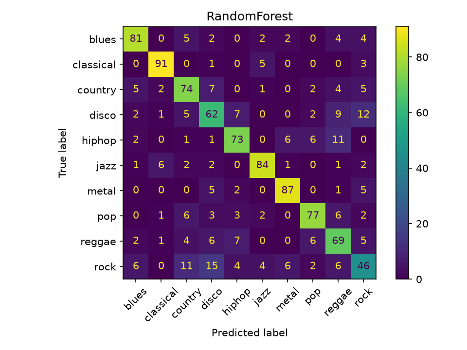
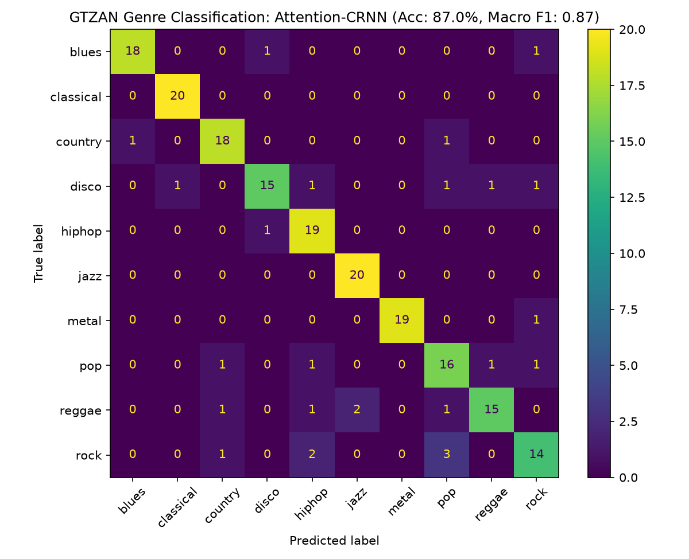
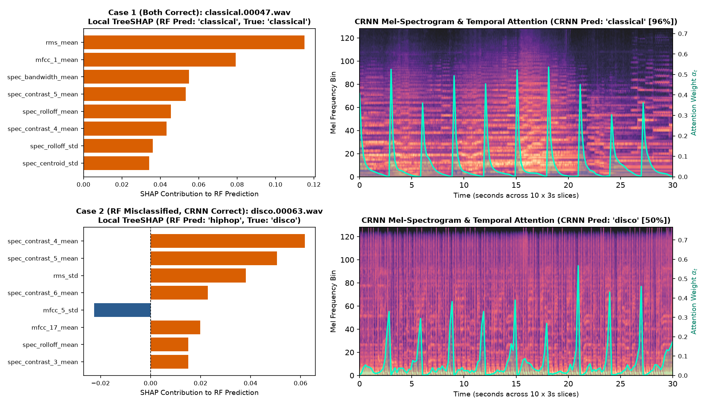
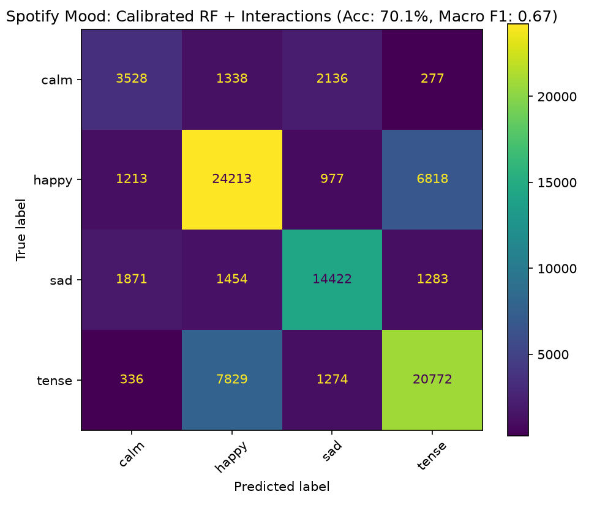
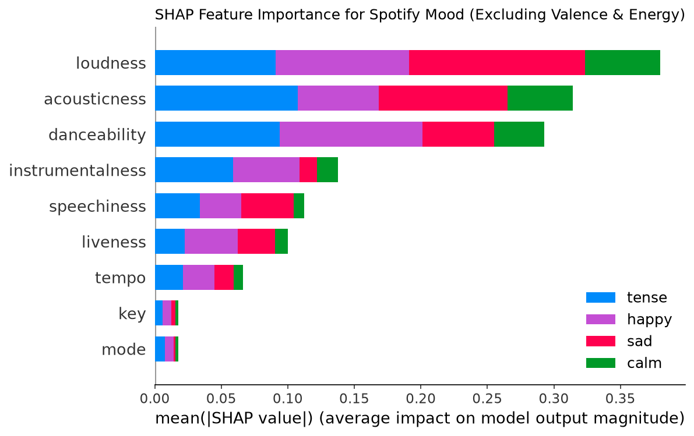

# Explainable Music Genre & Mood Classification

An end-to-end Music Information Retrieval (MIR) pipeline for **audio genre classification** and **musical mood recognition**, built with a dual-layer explainability framework that compares **TreeSHAP feature attributions** on handcrafted signal descriptors against **learnable Temporal Attention weights** on 2D log-Mel spectrograms (Attention-CNN and Attention-CRNN).

---

## Key Features & Engineering Highlights

* **Parallelized Audio Signal Processing:** Extracts 89 named statistical features per track (mean and std across 20 MFCCs, 12 Chroma pitch classes, Spectral Centroid, Bandwidth, Rolloff, 7-band Spectral Contrast, Zero-Crossing Rate, RMS Energy, and Beat-Tracked Global Tempo) across all CPU cores using `librosa` and `joblib`.
* **Zero-Leakage 3-Second Slice CRNN Pipeline:** Splits the 999 parent GTZAN tracks at the **song level** first (80/20 stratified split) before slicing each 30-second Mel-spectrogram into 10 non-overlapping 3-second segments (`128 x 128`), training a **2D-CNN + BiGRU + Temporal Attention (CRNN)** with song-level soft voting (**87.0% Accuracy, 0.869 Macro F1**).
* **Non-Circular Mood Modeling & Prior Calibration:** Derives 4-quadrant mood targets (*Happy, Tense, Sad, Calm*) on 89,741 deduplicated Spotify tracks via Russell's circumplex model (`valence >= 0.5`, `energy >= 0.5`), strictly excludes `valence` and `energy` from the inputs, and combines acoustic interaction features with prior threshold calibration to boost minority `calm` recall from `0.36 -> 0.48` (`0.667` Macro F1).
* **Cross-Paradigm Explainability:** Pairs local and global `TreeSHAP` attributions with CRNN temporal attention heatmaps on the exact same test tracks to show *which frequency features* vs. *which temporal windows* drive predictions.

---

## Benchmarks & Final Results

| Task & Dataset | Model Architecture | Validation Strategy | Accuracy | Macro Precision | Macro Recall | Macro F1 |
| :--- | :--- | :--- | :---: | :---: | :---: | :---: |
| **Genre** (GTZAN, 10 classes) | Random Forest (300 trees) | 5-Fold Stratified CV | 74.5% | 0.74 | 0.74 | 0.740 |
| **Genre** (GTZAN, 10 classes) | SVM (RBF Kernel, C=10) | 5-Fold Stratified CV | 77.6% | 0.78 | 0.78 | 0.776 |
| **Genre** (GTZAN, 10 classes) | 2D Attention-CNN (Full 30s) | 80/20 Track Split | 83.0% | 0.83 | 0.83 | 0.826 |
| **Genre** (GTZAN, 10 classes) | **Attention-CRNN (10x3s Soft Vote)** | **80/20 Track Split** | **87.0%** | **0.87** | **0.87** | **0.869** |
| **Mood** (Spotify, 4 classes) | Random Forest Baseline (9 features) | 5-Fold Stratified CV | **70.5%** | **0.69** | 0.65 | 0.660 |
| **Mood** (Spotify, 4 classes) | **Calibrated RF + Interactions** | **5-Fold Stratified CV** | 70.1% | 0.67 | **0.67** | **0.667** |
| **Mood** (Spotify, 4 classes) | HistGradBoost (Class-Balanced) | 5-Fold Stratified CV | 66.0% | 0.63 | 0.66 | 0.636 |
| **Mood** (Spotify, 4 classes) | Deep MLP (128 -> 64, Scaled) | 5-Fold Stratified CV | 66.5% | 0.63 | 0.60 | 0.608 |

### Per-Genre F1-Score Breakdown (GTZAN)

| Genre | Random Forest | RBF-SVM | Attention-CNN | **Attention-CRNN** | Key Takeaway |
| :--- | :---: | :---: | :---: | :---: | :--- |
| **Classical** | 0.90 | 0.89 | **0.98** | **0.98** | Near-perfect separation via low ZCR & high spectral contrast |
| **Metal** | 0.86 | 0.87 | 0.86 | **0.97** | +0.11 F1 jump on CRNN with 1.00 precision |
| **Jazz** | 0.85 | 0.86 | 0.88 | **0.95** | BiGRU captures phrasing and brass/woodwind transitions |
| **Blues** | 0.81 | 0.82 | 0.82 | **0.92** | +0.10 F1 gain from 3-second slice soft voting |
| **Country** | 0.71 | 0.78 | 0.74 | **0.88** | +0.14 F1 improvement separating acoustic Country from Rock |
| **Hip-Hop** | 0.74 | 0.72 | **0.88** | 0.86 | 0.95 recall on rhythmic vocal cadence |
| **Disco** | 0.61 | 0.67 | **0.82** | 0.81 | +0.20 F1 over RF by preserving 4/4 groove over time |
| **Reggae** | 0.65 | 0.69 | **0.86** | 0.81 | Strong gain over summary stats via off-beat syncopation |
| **Pop** | 0.79 | 0.80 | **0.85** | 0.76 | High-frequency vocal production |
| **Rock** | 0.50 | 0.66 | 0.57 | **0.74** | **+0.17 F1 jump** on the hardest umbrella genre |
| **Macro Avg** | **0.740** | **0.776** | **0.826** | **0.869** | **+12.5% accuracy gain from RF to Attention-CRNN** |

---

## Visual Outputs & Explainability

### 1. Genre Classification Confusion Matrices (RF, SVM, CNN, CRNN)

  
  
  
  

### 2. Cross-Paradigm Case Study: Local TreeSHAP vs. CRNN Temporal Attention

  

### 3. Spotify 4-Quadrant Mood Classification & SHAP Importance

  
  

---

## Demo Website

A React site with a FastAPI backend: upload a song, watch the CRNN's attention while it plays, compare all four genre models, read TreeSHAP explanations, and explore mood predictions.

    pip install -r requirements.txt -r requirements-web.txt
    python scripts/export_models.py        # trains anything missing, saves models/
    python scripts/build_demo_samples.py   # pre-computed gallery for the site
    cd web && npm install && npm run build && cd ..
    python -m api                          # open http://127.0.0.1:8000

Full guide, development mode and Vercel deployment: [docs/WEBSITE.md](docs/WEBSITE.md).

---

## Project Structure

    iml-music-genre-mood/
    ├── data/
    │   ├── raw/                        # Raw datasets (gitignored: GTZAN Data/ & Spotify dataset.csv)
    │   └── processed/                  # Extracted CSVs & cached .npy Mel-spectrograms (gitignored)
    ├── reports/                        # Confusion matrices, SHAP plots, and CRNN attention figures
    ├── src/
    │   ├── extract_features.py         # Parallel 89-feature audio extractor (librosa + joblib)
    │   ├── baseline.py                 # 5-fold Stratified CV for Random Forest & RBF-SVM on GTZAN
    │   ├── explain_shap.py             # Multi-class TreeSHAP bar & per-genre beeswarm plots
    │   ├── make_spectrograms.py        # Converts WAV files to cached 128x1280 float16 Mel-spectrograms
    │   ├── train_cnn.py                # 2D CNN + Temporal Attention on full 30s spectrograms
    │   ├── train_crnn.py               # 2D CNN + BiGRU + Attention on 3s slices with song soft-voting
    │   ├── mood_baseline.py            # Spotify deduplication, 4-quadrant mood RF baseline & TreeSHAP
    │   ├── mood_final.py               # Engineered acoustic interactions + prior-calibrated Mood RF
    │   └── compare_explanations.py     # Side-by-side local TreeSHAP vs. CRNN attention case studies
    ├── api/                            # FastAPI backend serving live model & SHAP inference
    ├── web/                            # React + TypeScript interactive demo frontend
    ├── scripts/                        # Model export (export_models.py) & gallery builder scripts
    ├── docs/                           # Extended documentation & deployment guide (WEBSITE.md)
    ├── requirements.txt                # Core ML & audio signal processing dependencies
    ├── requirements-web.txt            # FastAPI & web server dependencies
    └── README.md

---

## Installation & Setup

1. **Install Prerequisites (Python 3.11, Git, FFmpeg):**

       brew install git python@3.11 ffmpeg

2. **Clone Repository & Create Virtual Environment:**

       git clone https://github.com/devanshrai23/iml-music-genre-mood.git
       cd iml-music-genre-mood
       python3.11 -m venv .venv
       source .venv/bin/activate
       pip install --upgrade pip && pip install -r requirements.txt

3. **Place Datasets in `data/raw/`:**
   * **GTZAN Genre Collection:** Extract into `data/raw/Data/genres_original/`.
   * **Spotify Tracks Dataset:** Extract `dataset.csv` into `data/raw/dataset.csv`.

---

## Reproducing the Full Pipeline

    python src/extract_features.py
    python src/baseline.py
    python src/explain_shap.py
    python src/make_spectrograms.py
    python src/train_cnn.py
    python src/train_crnn.py
    python src/mood_baseline.py
    python src/mood_final.py
    python src/compare_explanations.py
